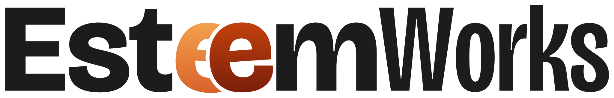
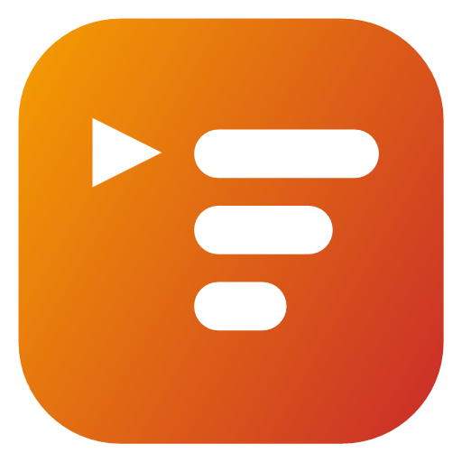
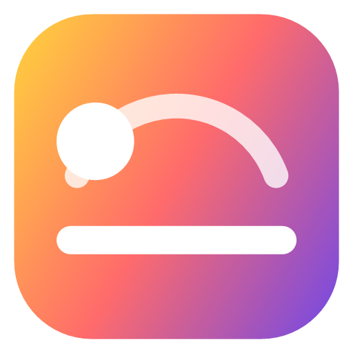

  <picture>
    <source media="(prefers-color-scheme: dark)" srcset="esteemworks-wordmark-ember-dark.svg">
    
  </picture>

<h3 align="center">Small apps that make Windows yours.</h3>

Free apps for Windows 11.

 

<table>
  <tr>
    <td width="96" align="center"></td>
    <td>
      <b><a href="https://github.com/esteemworks/StartQueue">StartQueue</a></b> 
      Your apps after sign-in, in your order: one startup order, profiles, quiet starts.
    </td>
  </tr>
  <tr>
    <td width="96" align="center"></td>
    <td>
      <b><a href="https://github.com/esteemworks/DynaTones">DynaTones</a></b> 
      Your desktop follows the sun: wallpapers through the day and light and dark from one plan.
    </td>
  </tr>
</table>

Two apps so far, more to come. Free and open source under the MIT license.

